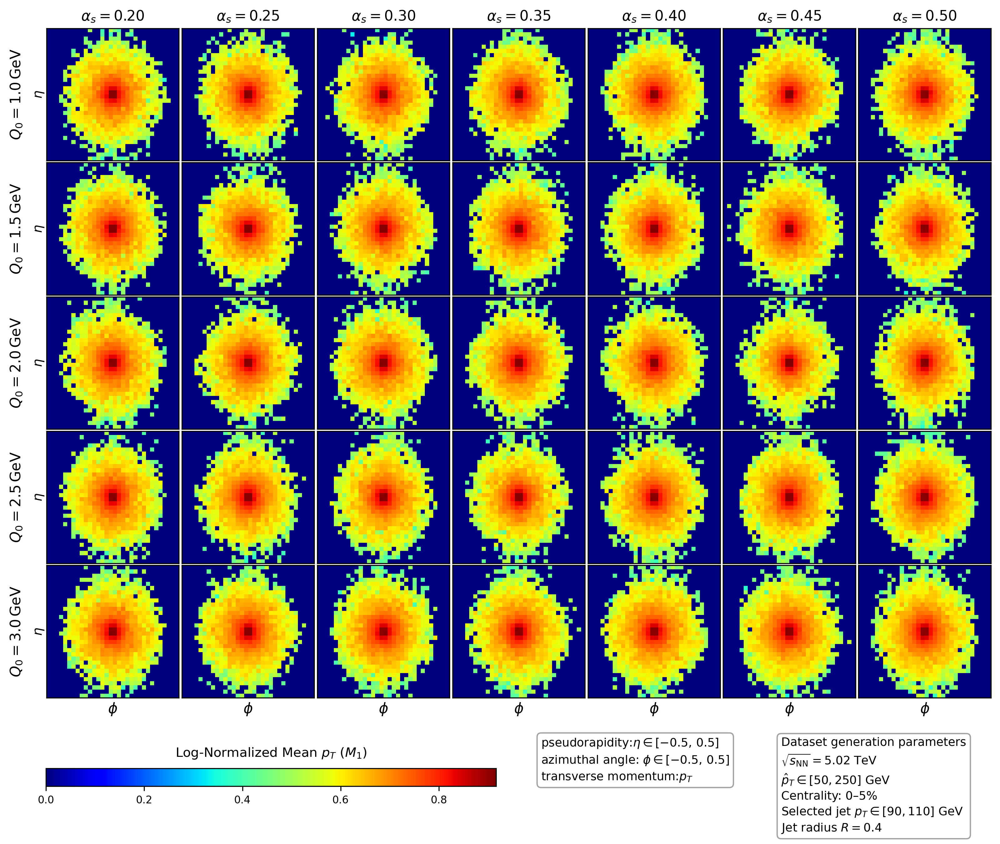
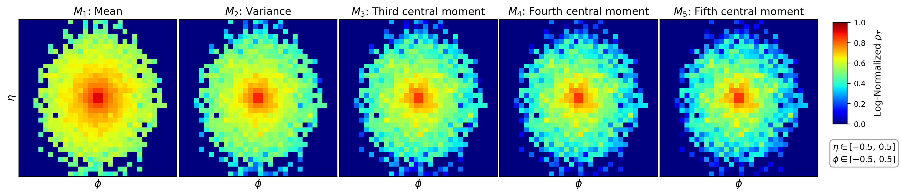
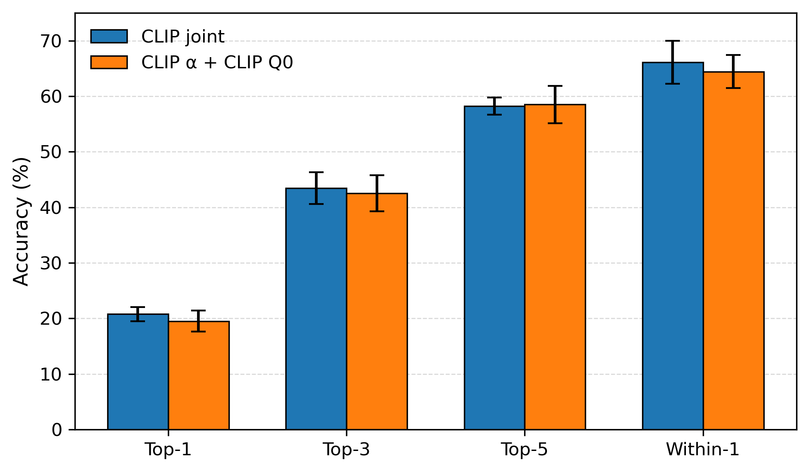
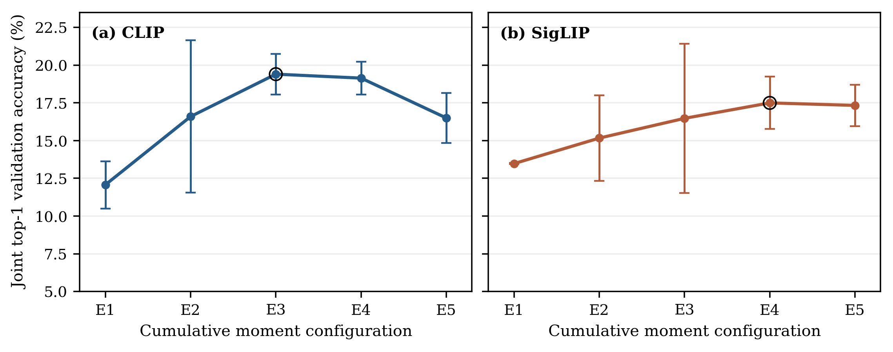

# ML-JET-Ext

**Multi-moment jet-image benchmarking for jet-quenching parameter inference**

ML-JET-Ext extends the original ML-JET research workflow to study whether computer-vision models can infer jet-quenching parameters from multi-moment representations of simulated heavy-ion collision jets. The repository contains dataset-building and audit utilities, PyTorch models, training and evaluation pipelines, reproducible experiment configurations, HPC/Slurm tooling, and manuscript-supporting analysis scripts.

The central prediction targets are the strong-coupling parameter **α_s** and the jet-medium switching scale **Q₀**. The project investigates vision-transformer transfer learning, CLIP/SigLIP image encoders, physics-aware classification losses, and independently trained single-task experts.

> **Evaluation status:** The reported T04-11 joint-versus-expert comparison is **validation-only**, not a held-out test result. Aggregate-level train/validation/test splits are disjoint, but this does **not** establish independence of the underlying source jets. See [Scope and limitations](#scope-and-limitations).

## Research questions

- How much information about jet-quenching parameters is retained by higher-order jet-image moments?
- How do ViT-based models and CLIP/SigLIP vision encoders compare on the same parameter-inference tasks?
- Do ordinal-aware and physical-error-aware losses improve classification or reduce physically large mistakes?
- Can independently trained α_s and Q₀ classifiers outperform a jointly trained two-head model when combined at inference?

## Dataset and representations

The extended benchmark covers **35 parameter configurations**, with:

| Property | Setting |
| --- | --- |
| α_s | 0.20, 0.25, 0.30, 0.35, 0.40, 0.45, 0.50 (7 classes) |
| Q₀ | 1.0, 1.5, 2.0, 2.5, 3.0 (5 classes) |
| Jet-image shape | 32 × 32 over pseudorapidity–azimuth (η, φ) |
| Representations | M1–M5, stored as five image channels |
| Aggregation | 500 jets per aggregate |
| Benchmark size | 400 aggregates/configuration; 14,000 aggregates total |
| Train / validation / test | 11,200 / 1,400 / 1,400 aggregates |
| Collision energy | √s_NN = 5.02 TeV |
| pTHat | 50–250 GeV |
| Centrality | 0–5% |
| Jet pT selection | 90–110 GeV |
| Jet radius | R = 0.4 |

The dataset-generation pipeline constructs aggregate jet images and moment channels, then applies the configured normalization. The experiment families vary which cumulative subset of M1–M5 is supplied to each model. Source data and generated aggregate files are **not distributed as ordinary Git-tracked repository files**.

Data-construction code and audits are under [`dataset_builder/`](dataset_builder/); the moment-data loader is under [`data/`](data/). The dataset split CSVs and associated provenance must accompany a local dataset copy.

### Example jet-image representations



*First-moment (M1) aggregate jet images across the 7 × 5 (α_s, Q₀) parameter grid. Each image summarizes the spatial structure of a simulated-jet aggregate; the grid illustrates how the benchmark samples parameter space.*



*The five moment channels M1–M5 for one fixed aggregate, showing how the input representation changes with moment order. These are complementary channels of the same sample, not five independent events.*

## Models and experiments

| Area | What is investigated | Where to look |
| --- | --- | --- |
| Legacy ML-JET and T02 | Compatibility with historical training and multi-moment data loading | [`models/`](models/), [`train_utils/`](train_utils/), [`docs/`](docs/) |
| T03 — ViT | Transfer learning and cumulative M1–M5 moment ablations | [`experiments/`](experiments/), [`tools/run_t03.py`](tools/run_t03.py), [`docs/README_T03_RUNTIME.md`](docs/README_T03_RUNTIME.md) |
| T04-06 — CLIP/SigLIP | S1–S4 strategies × E1–E5 moment settings × three seeds | [`experiments/t04/config/`](experiments/t04/config/), [`models/moment_vlm.py`](models/moment_vlm.py) |
| T04-07 — Loss ablations | Cross-entropy, CE + ordinal-CDF, and CE + physical-MAE | [`train_utils/ordinal_loss.py`](train_utils/ordinal_loss.py), [`tools/t04_07_production.py`](tools/t04_07_production.py) |
| T04-10 — Single-task experts | Separate α_s-only and Q₀-only heads with CLIP/SigLIP | [`models/t04_10_single_head.py`](models/t04_10_single_head.py), [`train_utils/t04_10_training.py`](train_utils/t04_10_training.py) |
| T04-11 — Evaluation | Joint models vs. independently composed experts, top-k/within-k, confusion matrices | [`tools/t04_11/`](tools/t04_11/) |

**Terminology:** The independently trained expert composition is a *modular ensemble* evaluated at inference time; it is not presented as a learned-gating mixture-of-experts architecture. Strict zero-shot and few-shot evaluation with full image–text models is a separate, still-open research task ([#27](https://github.com/hmehryar/ml-jet-ext/issues/27)).

## Selected validation results

The final T04-11 comparison uses **1,400 validation aggregates**, three paired seeds (**42, 123, 2026**), and BF16 inference. Entries are mean ± sample standard deviation across seeds.

| System | Joint top-1 | Joint top-3 | Joint top-5 | Joint within-1 |
| --- | ---: | ---: | ---: | ---: |
| Jointly trained CLIP | **20.76 ± 1.30%** | **43.45 ± 2.84%** | **58.21 ± 1.57%** | **66.10 ± 3.89%** |
| CLIP α_s + CLIP Q₀ experts | 19.50 ± 1.92% | — | — | 62.12 ± 3.18% |

Here, **top-k** ranks candidate joint parameter pairs and **within-1** allows an ordinal error of at most one class step in each parameter. The missing composed-expert top-3/top-5 entries are intentionally omitted rather than estimated; those values can be regenerated from the validated local evaluation outputs.

These are **validation-set** measurements used during the research process; do not interpret them as an unbiased test-set generalization estimate.

### Visual comparisons



*Joint top-k and ordinal within-1 accuracy for the jointly trained CLIP model and independent CLIP α_s/Q₀ experts. Bars show three-seed validation means; error bars show sample standard deviation. Top-k ranks the 35 joint parameter pairs.*



*Moment-representation ablation across CLIP/SigLIP strategies S1–S4 and cumulative M1–M5 inputs. This is a research-validation comparison, not a held-out test benchmark.*

## Repository layout

```text
ml-jet-ext/
├── config.py                 # Configuration and dataset-path resolution
├── data/                     # Dataset loading, including moment data
├── dataset_builder/          # Construction, audit, and figure-generation workflows
├── models/                   # ViT, CLIP/SigLIP, and single-head model definitions
├── train_utils/              # Training, losses, checkpoints, and evaluation helpers
├── experiments/              # Versioned experiment configurations and protocols
│   └── t04/config/           # T04 model/strategy/seed YAML matrices
├── tools/                    # Experiment launch, audit, export, and analysis scripts
│   └── t04_11/              # Cached-prediction export and expert evaluation
├── slurm/                    # HPC job launchers
├── tests/                    # Python regression and integration tests
├── docs/                     # Experiment-stage notes and execution guidance
│   └── readme_figures/        # Four curated, web-sized manuscript figure previews
└── pytest.ini                # Restricts normal test discovery to tests/
```

The repository also includes historical notebooks and simulation/event-processing components. Some workflows have additional environment or external software requirements; consult the relevant stage documentation before running them.

## Getting started

### 1. Clone and prepare an environment

```bash
git clone https://github.com/hmehryar/ml-jet-ext.git
cd ml-jet-ext

# Activate an existing environment with the project's required packages.
# Key Python packages include PyTorch, NumPy, PyYAML, and pytest.
python -m pytest -q tests/
```

There is no verified one-command dependency installer documented here. Install the Python and model-backbone dependencies appropriate to the specific experiment, and use a CUDA/BF16-capable compute environment for GPU training. Running the test suite does not require submitting Slurm jobs.

### 2. Point to a locally available dataset

For **moment-mode** training, the configuration loader supports environment overrides:

```bash
export MLJET_DATASET_ROOT=/absolute/path/to/your/moment-dataset
export MLJET_OUTPUT_ROOT=/absolute/path/to/your/run-outputs
```

A prepared dataset must include the expected `splits/train.csv`, `splits/val.csv`, and `splits/test.csv`, alongside the aggregate arrays and metadata. Preserve the original split/provenance files; do not regenerate splits for direct comparisons with reported experiments.

### 3. Inspect and reproduce a specific experiment

For the isolated T03 runner, see [`docs/README_T03_RUNTIME.md`](docs/README_T03_RUNTIME.md). For example, an **inspection/preparation** workflow (not a job submission) is:

```bash
python tools/run_t03.py \
  --config experiments/exp_03_cumulative_moment_ablation_v3/config/E2_m1_m2_pretrained.yml \
  --profile hpc \
  --dataset-root "$MLJET_DATASET_ROOT" \
  --output-root "$MLJET_OUTPUT_ROOT" \
  --device cuda \
  --prepare-only
```

The selected experiment can require a compatible pretrained checkpoint or additional command-line arguments: read the referenced stage documentation and the config before running it. Do **not** run GPU training on an HPC login node.

### 4. Run focused evaluation checks

```bash
python -m pytest -q tools/t04_11/test_t04_11_eval.py
```

To **finalize an already generated** T04-11 validation evaluation (rather than train models or generate missing prediction caches):

```bash
python -m tools.t04_11.finalize_validation
```

This requires existing, locally available `results/t04_11/evaluation/val/` and `results/t04_11/predictions/val/` artifacts. It does **not** download checkpoints, produce inference caches, or evaluate the held-out test split.

## Reproducibility and artifact policy

- Keep raw/generated datasets, checkpoints, prediction caches, Slurm logs, CSV result tables, and full-resolution generated manuscript figures outside Git tracking; retain them in approved storage with their hashes and manifests. The four curated, downsampled README PNG previews in `docs/readme_figures/` are the only intentional image-asset exception.
- Commit Python source, configurations, protocols, tests, and scripts needed to regenerate research outputs.
- Use the recorded seeds, parameter class mapping, split hashes, checkpoint hashes, selected epochs, and BF16/FP32 settings when comparing runs.
- Treat validation-based checkpoint and model selection as exploratory. Do not use the held-out test set for selection.
- Consult stage-specific docs in [`docs/`](docs/) for HPC preparation, snapshot isolation, recovery, and acceptance tests.

## Scope and limitations

1. **Validation-only findings:** T04-11 did **not** evaluate on the held-out test set. Its accuracy estimates should not be described as final held-out performance.
2. **Source reuse:** The split is aggregate-disjoint, but the available audits identify source-level jet reuse. Aggregate-disjoint does not imply source-jet-disjoint, and source independence should not be claimed without a successful additional audit.
3. **Training protocol comparability:** Historical ViT-transfer and CLIP/SigLIP results were not all produced under an identical training protocol; comparisons require attention to initialization, epoch budget, and checkpoint provenance.
4. **Open work:** Strict zero-/few-shot VLM benchmarks, full ViT single-head parity, learned MoE gating, and final publication-package tasks are not represented as completed results.

## Project tracking and citation

Research tasks and current completion status are tracked in [GitHub Issues](https://github.com/hmehryar/ml-jet-ext/issues). The consolidated T03–T04 implementation was merged via [PR #32](https://github.com/hmehryar/ml-jet-ext/pull/32).

This project is under active research development. If you use the dataset, code, or results, please cite the corresponding ML-JET / ML-JET-Ext publication once its bibliographic information is finalized. A formal citation entry has not been supplied here to avoid inventing publication metadata.
